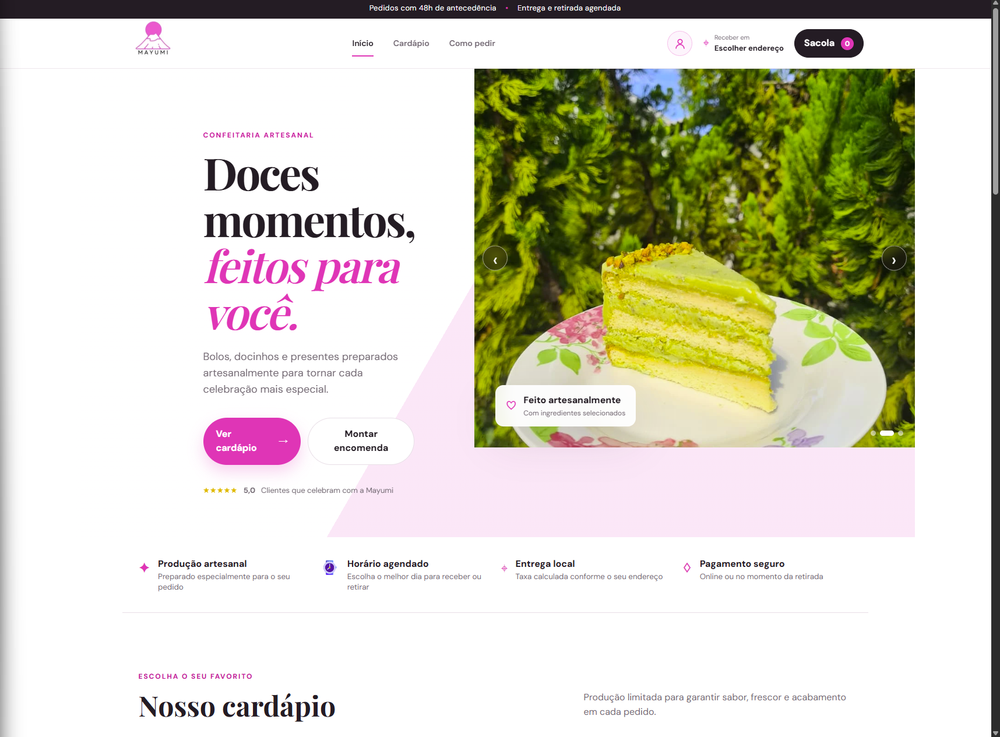
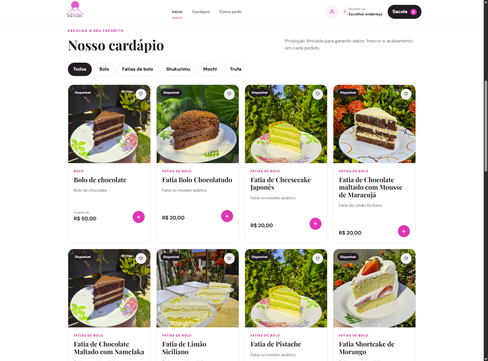
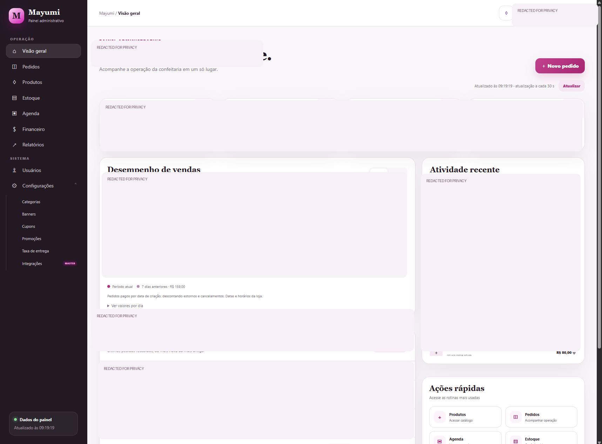

# Mayumi Confectionery

### Custom Full Stack Ordering & Business Management Platform — Engineering Showcase

**PHP · JavaScript · HTML · CSS · SQL · Product Catalog · Promotions · Order Management**

A client-focused confectionery storefront and administration system developed within the **Valorium Sistemas** ecosystem.

[Storefront](#storefront-preview) · [Administration](#administration-preview) · [Architecture](docs/architecture.md) · [Ordering Workflow](docs/ordering-workflow.md) · [Engineering Challenges](docs/engineering-challenges.md) · [Security](docs/security.md)

---

## Overview

Mayumi is a custom confectionery ordering platform with a customer-facing catalog and an administrative workspace. The project emphasizes product presentation, category navigation, ordering workflows and configurable commercial operations for a confectionery business.

This is a **public technical case study**, not a production code repository or downloadable application. Screenshots document visible interfaces; they do not independently verify payment, delivery, or third-party integration behavior.

## Storefront preview

### Home page

### Product catalog

The interface presents cake slices and other confectionery categories, product cards, availability indicators, favorites and cart entry points. The screenshots show a customer-facing design rather than proof of completed checkout transactions.

## Administration preview

The dashboard screenshot has been **intentionally redacted** to avoid exposing customer names, order references, transaction details, financial figures, and operational activity. Redacted regions are not evidence of specific financial or performance results.

## Functional areas

| Area | Engineering scope |
| --- | --- |
| Storefront | Responsive catalog, categories and product browsing |
| Product management | Product information, images and catalog presentation |
| Promotions | Product-specific promotional rules and administrative controls |
| Orders | Ordering interfaces and administrative order views |
| Scheduling | Order planning and scheduled delivery or pickup interfaces |
| Administration | Dashboard, inventory, reports and user-facing management screens |
| Integrations | Integration settings and workflows, subject to validation of the private implementation |

Feature descriptions refer to the project scope and observed interface. They do **not** assert that every workflow is fully released or independently tested.

## Technology stack

- **Frontend:** HTML, CSS, JavaScript
- **Backend:** PHP
- **Data:** SQL / relational database concepts
- **Engineering:** Responsive UI, product modeling, order state, promotions, permissions and integrations

## Architecture

A conceptual separation between the storefront, backend services, persistence and administrative workflows is documented in [Architecture](docs/architecture.md).

## Engineering focus

- Translating real confectionery business needs into a usable online storefront.
- Handling category-specific products, product images and commercial rules.
- Designing promotional conditions around eligible products rather than unrelated cart items.
- Separating customer-facing shopping experiences from administrative operations.
- Considering access controls, input validation, privacy and maintainable application boundaries.

See [Engineering Challenges](docs/engineering-challenges.md) for implementation considerations and validation limits.

## My role

**Guilherme Langkammer** — Founder & Software Developer, Valorium Sistemas. Project planning, application development, UI implementation, business workflows, troubleshooting and testing.

## Contact

- [GitHub](https://github.com/Guilherme-Langkammer)
- [LinkedIn](https://www.linkedin.com/in/guilherme-de-paula-langkammer-1a64b0344/)
- [Email](mailto:guilhermelangkammer008@gmail.com)

## Notice

This repository contains **portfolio documentation only**. Proprietary source code, customer data, production credentials, internal configurations and deployment details are not published. Product photographs and the Mayumi brand remain the property of their respective owners; publication should be authorized by the client.
