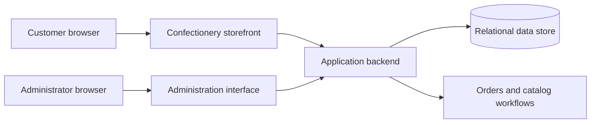

# Conceptual Architecture

This is a conceptual diagram for portfolio communication. It intentionally omits production endpoints, schema, credentials, hosting topology and private integration details.

## Design boundaries

- The storefront handles discovery, cart entry points and customer-facing forms.
- The administrative interface exposes catalog, order and operational workflows.
- Server-side logic should validate authorization, product eligibility, totals and order transitions.
- Database operations should be transactional where multiple related records change.
- Integrations should be isolated behind validated service boundaries.

The diagram describes design concerns, not a verified inventory of deployed components.
