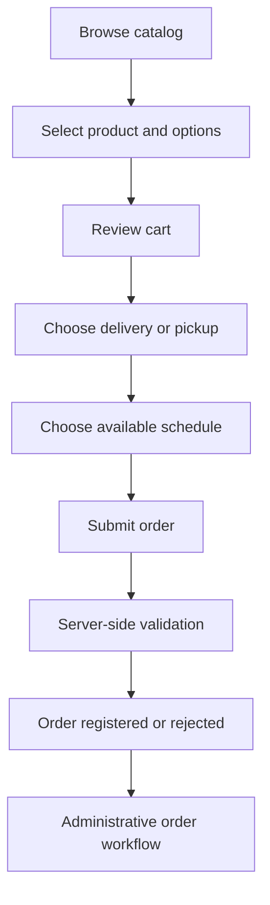

# Ordering Workflow

This is a **conceptual** customer journey based on the showcased product direction. Payment confirmation, external integrations, scheduling constraints and end-to-end production behavior must be verified against the private build before being claimed as released.

## Important considerations

- Validate availability and promotional eligibility on the server.
- Recalculate totals independently of browser-supplied values.
- Keep customer-visible order state consistent with administrative changes.
- Protect customer contact and address information.
- Avoid duplicate submissions and ambiguous payment/order states.
